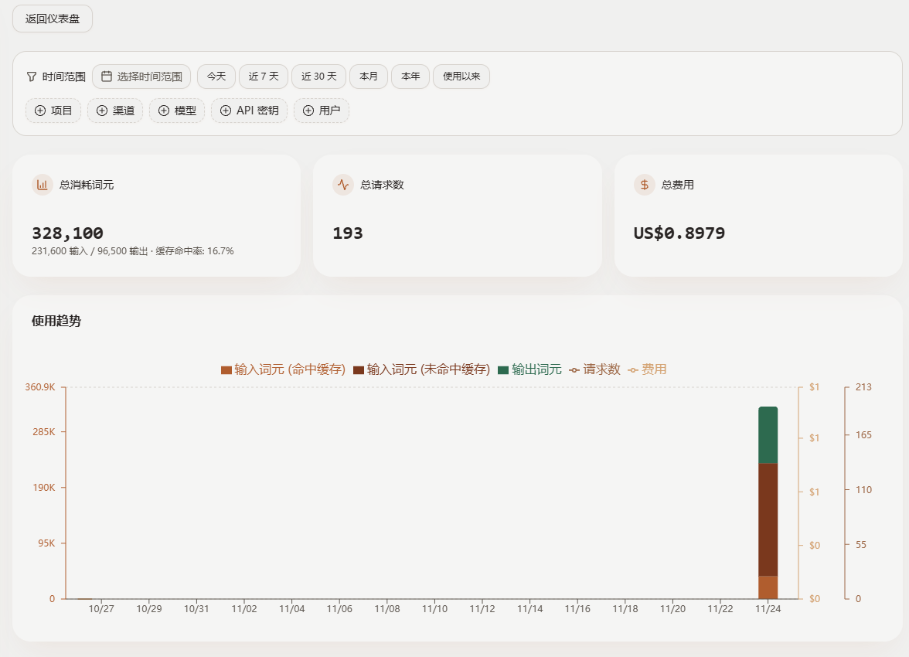
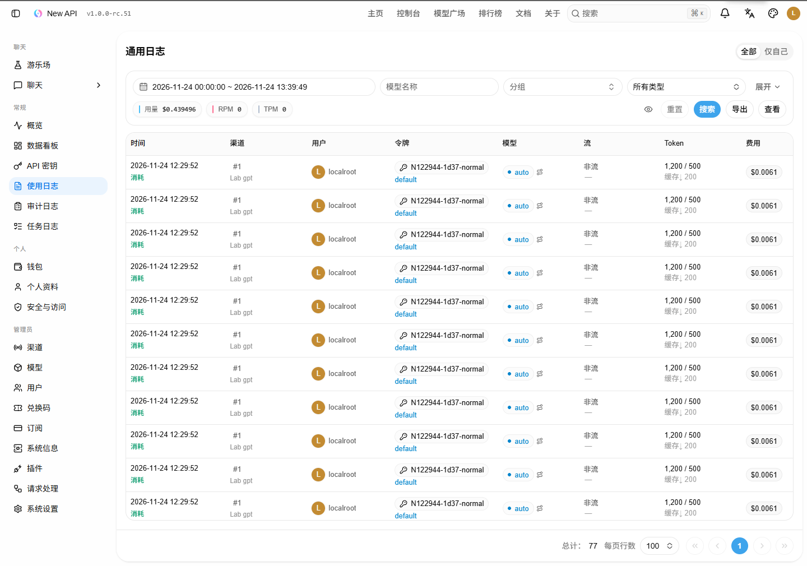

# LLM 网关实验｜AxonHub vs New API

在同一台 Windows 电脑上，以 Docker 和模拟上游对两款开源 LLM 网关做黑盒测试。关注四件事：上游失败时怎么切换，用户与密钥如何管理，能否用固定的 `auto` 隐藏内部模型换代，以及用量与费用能否对账。

**简要结论** · 两款都跑通了 `auto` 主备路由。按本次覆盖的用例，团队内部试点优先考虑 **AxonHub**，因为已验证项目成员隔离、一次性邀请、三种 Key 额度和分渠道价格。**New API** 适合进一步评估以账号、令牌、额度为核心的运营场景。两款都需要在接入真实上游前复核退避和流式结束条件。

| 实验问题 | AxonHub `v1.0.0-rc.4` | New API `v1.0.0-rc.51` |
| --- | --- | --- |
| GPT 优先，失败走备用 | 503、429、超时、上游 401 各 **12/12** 次回退成功 | 独立批次中相同场景各 **4/4** 次回退成功 |
| 是否等满 `Retry-After: 2` | 在允许一次同渠道重试的补充配置下，间隔 **213.2–215.4 ms** | 在只剩主渠道的独立用例中，间隔 **3.25–3.96 ms** |
| `auto` 与模型换代 | 客户端请求和完整响应的 `model` 保持 `auto` | 客户端继续请求 `auto`，响应 `model` 暴露实际模拟上游 ID |
| 首个流式事件前故障 | 可回退并得到完整 SSE | 可回退并得到完整 SSE |
| 流式已输出后断开 | **9/9** 条仍是 HTTP 200，只有半段正文，无 `[DONE]`，无用量 | 独立批次 **4/4** 条同样只有半段正文，仍发 `[DONE]`、估算用量并记费，缺少正常结束原因 |
| Key 与成员 | 已验证项目隔离、Key 启停、一次性邀请及请求数、Token 和费用额度 | 已验证账号级隔离、Key 启停、过期、模型白名单及余额耗尽 |
| Token 和费用 | 按渠道配置模拟单价，按项目及 Key 对账。分析页面显示非零费用 | 统一 `auto` 模拟倍率。独立批次 76 条消费记录合计 **US$0.439496**，与网页汇总一致 |

两组同渠道重试的策略不同，时间范围用于说明各自配置下的实际行为，不能拿来排名。完整实验只使用模拟 GPT 和模拟 DeepSeek，没有真实模型吞吐、真实费用或供应商风控压测数据。

## 阅读路径

1. [实验方法与数据口径](docs/experiment-method.md) · 版本、模拟协议、故障注入、统计口径和复现实验步骤。
2. [AxonHub 实验报告](docs/axonhub-results.md) · 主备路由、流式边界、项目成员、Key 配额和费用对账。
3. [New API 实验报告](docs/new-api-results.md) · 独立实验、限流时序、工具调用、用户权限、用量日志和费用。

## 界面实录

| AxonHub · 用量分析 | New API · 使用日志 |
| --- | --- |
|  |  |

另见 [New API 主备渠道配置截图](images/new-api-channel-priorities.png)。截图分别来自不同实验实例，不能按图中的金额高低直接比较成本。

## 数据下载

| 文件 | 内容 |
| --- | --- |
| [request-results.csv](evidence/request-results.csv) | **537 条**逐请求结果。含所属批次、HTTP、耗时、实际渠道路径和可用的用量字段 |
| [experiment-evidence.json](evidence/experiment-evidence.json) | **633 次**模拟上游尝试的归一化事件，以及用量、费用、配额和邀请核验记录 |

数据分为 AxonHub 重复验证 213 条、New API 独立实验 100 条、补充实验 224 条。补充实验含 AxonHub 31 条和 New API 193 条，部分早期批次只完成调用测试。公开数据保留模拟结果和对应关系，省略凭据、个人信息、环境绝对路径及自由文本错误载荷。数字仅适用于文中测试版本与配置。

项目来源：[AxonHub](https://github.com/looplj/axonhub) · [New API](https://github.com/QuantumNous/new-api)
