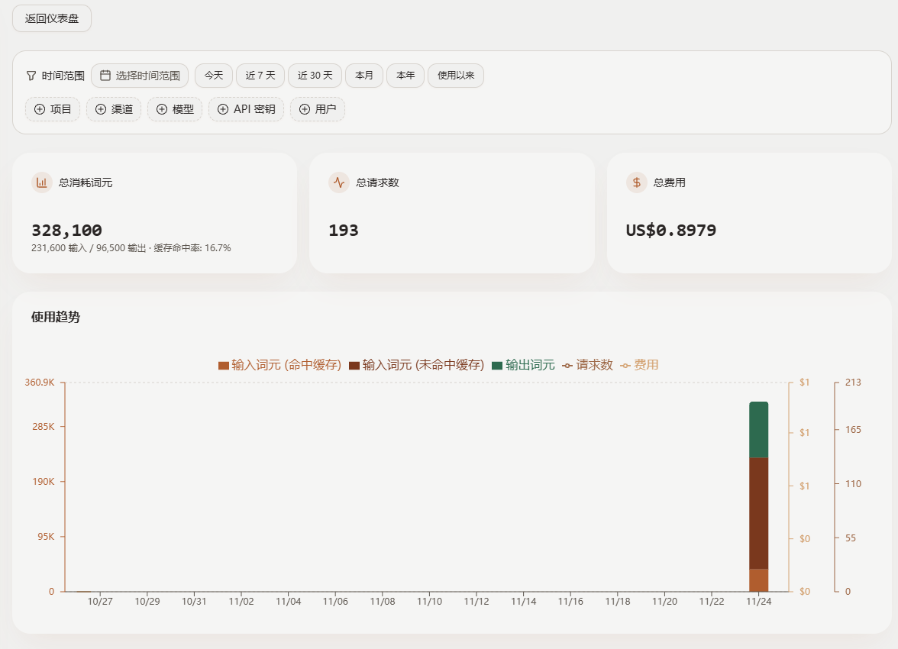

# AxonHub 实验报告

[返回总览](../README.md) · [实验方法](experiment-method.md) · [逐条结果](../evidence/request-results.csv)

## 路由、认证和流式边界

最初的渠道连通性用例返回预设文本 `AXONHUB_MOCK_OK`，本地界面记录 0.04 秒和 12 输入、5 输出。随后独立实例完成 4 批、213 条请求，对应 253 次模拟上游尝试。客户端返回 160 条完整成功、9 条 HTTP 200 的半段流、28 条 401、4 条 422、12 条 503。

| 用例 | 结果 |
| --- | --- |
| 正常非流式与 SSE | 20 条普通请求均到 GPT，12 条正常流均有 `[DONE]` 和 usage |
| 主渠道返回 503、429、401 或响应超时 | 每种各 12/12 到备用，切换后客户端返回 HTTP 200 |
| 主渠道恢复 | 503、429、超时后的 36 条探针均回到 GPT |
| 主备都 503 | 12/12 返回 503 |
| SSE 首事件前返回 503 | 12/12 切换成功，流完整结束 |
| SSE 已开始后断开 | 9/9 为 HTTP 200 的部分文本，无 `[DONE]`、无 usage、无备用尝试 |
| 模型更新 | 换成 GPT v2 后 12/12 仍用 `auto` 调用成功。成功响应对外仍报 `auto` |
| 工具调用补测 | 主、备各 3 条，均返回 `lab_lookup` 和可解析的相同参数 |

主渠道上游 401 可能由备用渠道成功响应掩盖。无效、缺失、停用的客户端 Key 则在网关入口被拒绝，没有上游流量。不存在的模型返回 422。

### 同渠道 429 重试

模拟上游返回 `Retry-After: 2`，三次轨迹均为 GPT 429 → GPT 429 → 备用 200。允许同渠道重试一次、策略间隔 200 ms 时，两次 GPT 到达间隔依次为 **214.7、215.4、213.2 ms**。应用日志记录了 2 秒冷却，实际同渠道重试未等满。该结论仅适用于测试配置。

## 项目、成员和额度

- A Key 停用后 12/12 返回 401。B 在相同窗口 4/4 继续成功。重新启用 A 后 4/4 成功。
- A 服务账户把管理请求显式指向 B 时 4/4 HTTP 403。两个普通成员测试均只能看到 A，对 B 的读取收到 GraphQL 权限错误。
- 本机一次性项目邀请只能领取一次。首次 HTTP 200，得到 A 项目成员权限，第二次 HTTP 400。未测试邮箱发送。
- 每种 Key 配额分别测试 4 次。2 次请求、3,400 Token、US$0.01220 三种限制都得到 200、200、403、403。1,300 Token 的限制先允许完成一次 1,700 Token 的响应，后续三次 403。尚未测试并发时超过额度的边界。

## 费用与仪表板

固定模拟用量为 1,000 未缓存输入、200 缓存输入、500 输出。GPT 的模拟单价为 US$2、US$0.50、US$8 每百万 Token，得到 US$0.00610／条。备用渠道为 US$1、US$0.25、US$2，得到 US$0.00205／条。

| 每个完整对账批次 | GPT | 备用 | Token | 费用 |
| --- | ---: | ---: | ---: | ---: |
| A 项目 | 21 | 15 | 61,200 | US$0.15885 |
| B 项目 | 4 | 0 | 6,800 | US$0.02440 |
| 合计 | 25 | 15 | 68,000 | US$0.18325 |

三轮完整对账合计 120 条、204,000 Token、US$0.54975。第二批调用保留，成员清理脚本使用了错误状态枚举导致当批没有采集用量与成员核验，修正后重跑。截图为后续隔离实例累计数据，含补测，显示 193 条计量请求、328,100 Token 和 US$0.8979。

[模型关联官方文档](https://github.com/looplj/axonhub/blob/v1.0.0-rc.4/docs/en/guides/model-management.md)
