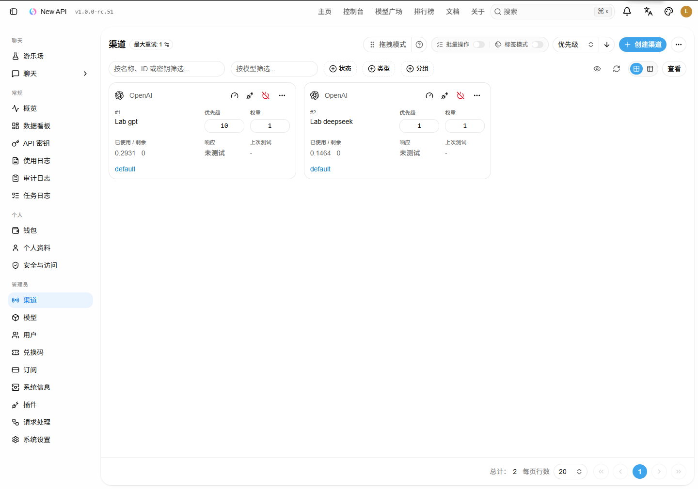
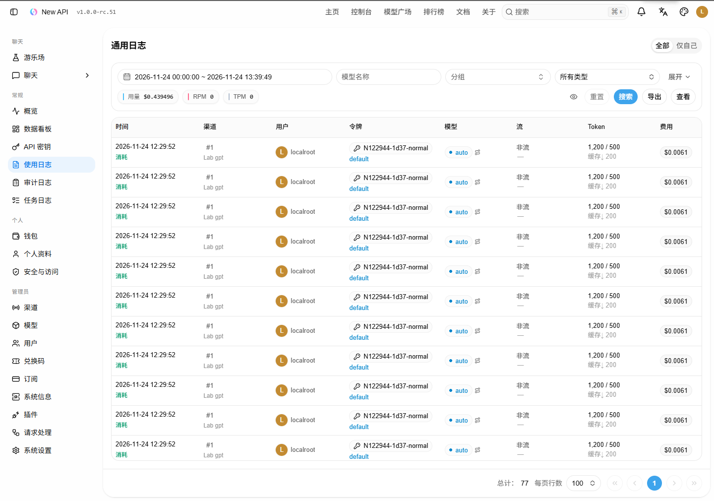

# New API 独立实验报告

**日期** 2026-11-24 · **版本** `v1.0.0-rc.51` · **批次** `N122944-1d37
**实验对象** Windows Docker 中的独立 New API 实例 `http://127.0.0.1:8093
**证据** [逐条 CSV（筛选 new-api-standalone）](../evidence/request-results.csv) · [用量、权限及上游事件 JSON](../evidence/experiment-evidence.json)

## 1. 实验结论

| 验证问题 | 本次答案 | 需要在部署前确认 |
| --- | --- | --- |
| **GPT 用得多，遇到限流或故障怎么办？** | 模拟 GPT 返回 429、503、超时或上游 401 时，各 **4/4** 次切到模拟 DeepSeek。主渠道恢复后，**12/12** 条正常探针回到 GPT。 | 只剩 GPT 时，同渠道重试间隔 **3.25–3.96 ms**，没有等满模拟上游要求的两秒。真实配额与退避需要单独验证。 |
| **Key 和成员好不好管？** | 测过普通用户与管理员的日志隔离、Key 启停、过期、模型白名单和余额用完后的拒绝。已停用本轮的 5 把测试 Key 和 1 名普通测试用户。 | 验证的是账号级的个人权限。团队需要的角色分工、部门分组、邀请或类似项目成员的管理流程仍待验收。 |
| **能否让用户只填写 `auto`？** | **可以。** 同一个 `auto` 映射到 GPT 主渠道，失败时走 DeepSeek，换成模拟 GPT v2 后 **4/4** 次仍成功。常规工具调用和回退后工具调用均 **4/4** 成功。 | 客户端响应中的 `model` 会显示命中的上游 ID。对必须固定响应模型字段的客户端，需要兼容性验证。接真实模型后仍要核验具体 API 格式。 |
| **Token 和费用能看清楚吗？** | 真实页面可查看按渠道、用户、Key、模型的记录。汇总 **219,748 额度单位 = US$0.439496**，与网页一致。单条正常请求的 Token、缓存量和费用与手算一致。 | 本次按对外 `auto` 模型配置统一倍率。真实供应商的分渠道成本、发票和部分生成的实际计费仍需逐项对账。 |

**定位**：New API 可以做本地兼容网关和备选中转站。最重要的待验证项是实际退避、流式完整性及团队权限是否贴合现网。当前证据不足以支持直接替换现有生产网关。

## 2. 实验设置和统计口径

| 配置项 | 实验值 |
| --- | --- |
| 镜像与数据库 | `calciumion/new-api:v1.0.0-rc.51`，D 盘持久化 SQLite |
| API | `POST /v1/chat/completions`，流式设置 `include_usage` |
| 主渠道 | `Lab gpt`，优先级 **10**，`auto → lab-gpt-v1`，最后切换到 `lab-gpt-v2` |
| 备用渠道 | `Lab deepseek`，优先级 **1**，`auto → lab-deepseek` |
| 类型与分组 | 两条渠道均采用 OpenAI Chat Completions 兼容类型，测试 Token 分组为 `default` |
| 重试、超时 | `RetryTimes=1`，转发超时 1 秒，实验渠道自动停用关闭。模拟 GPT 超时用例在上游等待 3 秒 |
| 正常模拟响应 | 1,200 输入、500 输出，总计 1,700，其中 200 输入为缓存命中 |
| 验证方法 | 逐条比对客户端 HTTP、SSE 结束信号、响应模型、模拟上游实际路径、请求 ID、账单及余额。对照脚本执行断言 |

这里的 `auto` 是对外模型名，不是 New API 的 Auto Group。实际路由按渠道支持模型、模型映射与优先级设置。 [New API 固定版本](https://github.com/QuantumNous/new-api/releases/tag/v1.0.0-rc.51) · [官方渠道管理](https://docs.newapi.pro/en/docs/guide/feature-guide/admin/channel)



## 3. 调用、故障回退和流式边界

**100 条客户端请求对应 114 次模拟上游尝试。** 客户端结果为 76 条 HTTP 200、13 条 401、3 条 403、3 条 429、5 条 503。76 条 HTTP 200 中，72 条是完整响应或完整结构化工具响应，4 条是半段流。以下耗时都是本机数据，不能据此比较厂商延迟或推算生产吞吐。

| 场景 | 样本数 | 实际行为 | 端到端范围（ms） |
| --- | ---: | --- | ---: |
| GPT 正常 | 4 | GPT v1，完整响应 | 6–21 |
| 主渠道 503 | 4 | GPT 503 → DeepSeek 成功 | 10–32 |
| 主渠道 429 | 4 | GPT 429 → DeepSeek 成功 | 8–21 |
| 主渠道超时 | 4 | 约 1 秒后切到 DeepSeek，成功 | 1011–1038 |
| 主渠道上游 401 | 4 | 备用应答成功，客户端 HTTP 200 | 9–43 |
| 主备都 503 | 4 | 两次尝试后客户端 HTTP 503 | 14–36 |
| 503 后恢复 | 4 | 下一条正常请求回到 GPT | 12–35 |
| 429 后恢复 | 4 | 下一条正常请求回到 GPT | 10–27 |
| 超时后恢复 | 4 | 下一条正常请求回到 GPT | 10–23 |
| 仅 GPT 可用，持续 429 | 3 | 同一主渠道打两次，最终 HTTP 429 | 27–38 |
| 正常 SSE | 4 | 完整内容、usage、`stop` 和 `[DONE]` | 32–91 |
| 首个事件前失败 | 4 | 切到 DeepSeek，完整 SSE | 36–56 |
| 开始输出后断流 | 4 | 半段文本、无 `finish_reason`、有估算 usage 和 `[DONE]` | 231–252 |
| GPT 工具调用 | 4 | 函数名和参数与模拟上游一致 | 7–24 |
| 工具调用回退 | 4 | DeepSeek 透传同一函数名和参数 | 10–16 |
| 内部模型换成 v2 | 4 | 客户端仍请求 `auto`，上游模型 v2 | 9–32 |
| 4 并发客户端、12 条短请求 | 12 | 12 条全部成功，均命中 GPT v2 | 13–55 |
| 不存在的模型 | 1 | HTTP 503，`model_not_found`，无上游尝试 | 16 |

### 429 实际时序

- **备用可用**：模拟主渠道带 `Retry-After: 2` 返回 429，第二次尝试切到备用。主、备上游的到达时间差 **1.81–3.18 ms**。
- **只有主渠道可用**：临时停用备用，分别提交三条模拟限流请求。两次上游尝试都落到 GPT，同渠道间隔分别为 **3.96、3.82、3.25 ms**，客户端最终均收到 429。之后重新启用了备用渠道。
- **上游认证故障**：GPT 返回模拟 401 后，备用能交付成功结果。客户端的成功响应无法单独反映主渠道故障。生产时要看请求重试链和上游错误。

### 流已开始后断开

同一次模拟链路的对照结果如下。正常流和首事件前回退的完整流都有 `finish_reason: stop`。

| 观察点 | 正常完整流 | 这次故意断开的流 |
| --- | --- | --- |
| HTTP | 200 | 200 |
| 客户端正文 | 完整返回 | 只见 `MOCK_GPT_PARTIAL` |
| `finish_reason` | `stop` | 4/4 未出现 |
| 末尾 `[DONE]` | 有 | 4/4 仍有 |
| 使用量 | 上游返回 1,200 输入、500 输出 | 网关估算 21 输入、4 输出 |
| 请求日志详情 | 完整结束 | 4/4 为 `stream_status.end_reason=eof`，`status=ok` |
| 备用尝试 | 无需备用 | 4/4 无备用尝试 |

接入客户端不能单凭 HTTP 200 或 `[DONE]` 判断正文完整。练习可将客户端收到的终止原因和网关记账一起核验。

### 模型换代与工具

- 对外请求始终发 `model: auto`。改完映射后，4 条串行样本和随后 12 条短并发样本都实际发往模拟 GPT v2。返回体的 `model` 为 `lab-gpt-v2`。主备使用的是同一个用户输入模型名。
- 工具调用提供 `lab_lookup` 的结构定义。GPT 正常 4 次与 GPT 503 后 DeepSeek 接手 4 次，都返回 `tool_calls`、正确函数名和可解析参数 `{"query":"local"}`。此处只测试结构透传，未运行外部函数或验证真实模型如何选工具。
- 4 个并发客户端的 12 条短请求全部成功，本机整批用时 **93 ms**，单条 13–55 ms。这个样本只说明短并发下链路可用。

## 4. Key、用户与额度测试

| 场景 | 样本 | 实际结果 |
| --- | ---: | --- |
| 无效 Key | 4 | HTTP 401，无模拟上游流量 |
| 缺少 Key | 1 | HTTP 401，无模拟上游流量 |
| 管理员测试 Key 停用 | 3 | 3/3 HTTP 401，无模拟上游流量 |
| 停用期间普通用户持自己的 Key | 3 | 3/3 HTTP 200，自己的请求正常记账 |
| 管理员 Key 重新启用 | 3 | 3/3 HTTP 200 |
| 已过期 Key | 3 | 3/3 HTTP 401，无模拟上游流量 |
| Key 白名单未包含 `auto` | 3 | 3/3 HTTP 403，无模拟上游流量 |
| 普通用户读取自己的 Key 列表和日志 | 各 1 | HTTP 200，业务成功，只见自己的 Key 和个人记录 |
| 普通用户尝试读取管理员 Key 详情 | 1 | HTTP 200，但业务字段 `success=false`，显示 `record not found` |
| 普通用户读取管理员全局日志 | 1 | HTTP 403 |

**额度耗尽复测。** 给一把 Key 设置 6,100 单位。每条完整调用扣 3,050，本轮等待结算后再发下一条：

| 请求 | 客户端 HTTP | 已用余额单位 | 剩余额度单位 |
| --- | ---: | ---: | ---: |
| 1 | 200 | 3,050 | 3,050 |
| 2 | 200 | 6,100 | 0 |
| 3 | 401 | 6,100 | 0 |
| 4 | 401 | 6,100 | 0 |

独立额度 Key 的用量 API 返回 6,100。样本结束时两条完整请求统计到 3,400 Token。以结算后的余额作为证据，避免把短暂预扣读数当成最终费用。

## 5. 成本对账与页面复核

本次输入倍率 **1**、输出倍率 **4**、缓存输入倍率 **0.25**，默认分组倍率为 1。每条完整请求的计算为：

```tex
未缓存输入 = 1,200 − 200 = 1,000
每条额度   = 1,000 × 1 + 200 × 0.25 + 500 × 4 = 3,050
每条模拟费用 = 3,050 ÷ 500,000 = US$0.006100


| 结算类型 | 条数 | 输入 Token | 输出 Token | 其中缓存输入 | 额度单位 | 模拟费用 |
| --- | ---: | ---: | ---: | ---: | ---: | ---: |
| 完整响应（含工具结构） | 72 | 86,400 | 36,000 | 14,400 | 219,600 | US$0.439200 |
| 已开始后断开的流 | 4 | 84 | 16 | 0 | 148 | US$0.000296 |
| 合计 | **76** | **86,484** | **36,016** | **14,400** | **219,748** | **US$0.439496** |

半段流在本实验各记 `21 × 1 + 4 × 4 = 37`。非 HTTP 200 的请求均无消费日志。浏览器的「使用日志 → 通用日志」显示相同总费用 `$0.439496` 和完整样本的 `1,200 / 500`、缓存 200、单条 `$0.0061`。截图表格页脚的所有日志计数包含其他日志类型，消费口径以 76 条为准。此次确认了使用日志界面，独立趋势看板的抓取遇到登录跳转和管理端限流，未作为已验收项。 [官方日志说明](https://docs.newapi.pro/en/docs/guide/feature-guide/user/log) · [官方倍率说明](https://docs.newapi.pro/en/docs/guide/console/settings/rate-settings)



## 6. 复查与剩余边界

- **数据文件**：[逐条请求 CSV](../evidence/request-results.csv) 用 `gateway + marker` 关联上游事件。[归一化证据 JSON](../evidence/experiment-evidence.json) 保存上游事件及结算记录。
- **复现方法**：[固定版本、模型映射和故障用例](experiment-method.md)。截图记录的是本批次后的实例状态。
- **批次口径**：此次从新 SQLite 实例重跑。先前补充实验的 193 条 New API 请求未计入本报告。两批完整费用对账均为 36 条完整消费加 3 条半段流。
- **未验证**：真实 GPT／DeepSeek 调用及厂商账单、生产峰值和长期并发、其他 API 格式、迁移现有用户和历史数据。两条模拟渠道均在 Docker 内部。实验只接入 Docker 内部模拟服务。
